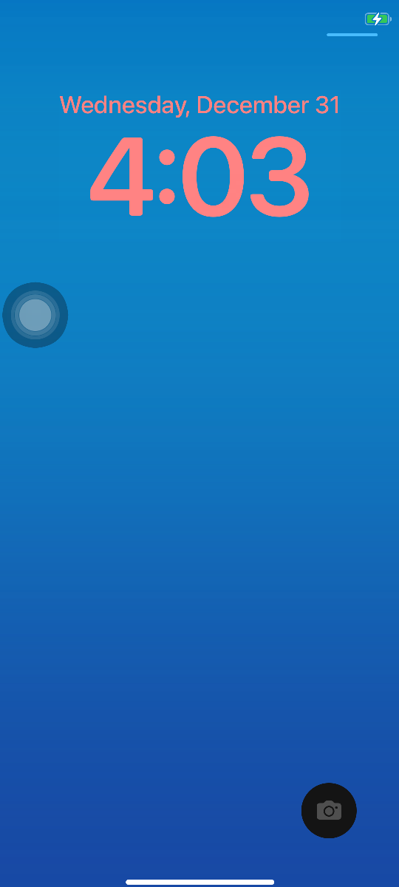

# SkyIOS

**iOS 16 on a Redmi Note 10 Pro.**

Runs Apple's XNU kernel (xnu-8796) and the unmodified iOS 16.7.16 iPhone X userland on the Xiaomi Redmi Note 10 Pro (`sweet`, Snapdragon 732G). Boots to the lock screen and home screen with GPU-rendered UI via CoreAnimation's Metal renderer on the Adreno 618 at 430 MHz.

> ⚠️ Experimental. Not a usable phone. Security is off. Erases Android user data.

## Why Rust?

The GPU driver, WLAN radio stack, and boot shim are written in Rust — not C or C++. In a bare-metal kernel context with no debugger and no MMU protection between drivers, one bad pointer corrupts memory silently and the phone reboots with no clue why. Rust's ownership model catches use-after-free, buffer overflows, and data races at compile time. The GPU command processor alone juggles ring buffers, DMA descriptors, SMMU page tables, and fence tracking across interrupt-like contexts — exactly the kind of code where C bugs hide for weeks. Rust also has zero-cost `no_std` support, so the compiled output is plain arm64 machine code linked directly into XNU with no runtime overhead. The tradeoff is slower iteration (the borrow checker fights you on MMIO register structs), but for kernel drivers that must not crash, it's worth it.

## Hardware Status

| Component | Status | Notes |
| --- | --- | --- |
| Boot | ✅ Working | `fastboot boot` shim → XNU, nothing flashed |
| CPU | ✅ Working | 8 cores (6×A55 + 2×A76), 1.8/2.3 GHz via OSM |
| RAM | ✅ Working | ~3.95 GiB upper DDR bank |
| Storage | ✅ Working | UFS host driver, HFS+ root in `userdata`, R/W |
| Display | ✅ Working | 1080×2400 panel, presented as iPhone X 1125×2436 |
| Touch | ✅ Working | Goodix GT9896 over I²C, HID digitizer |
| Buttons | ✅ Working | Power + volume (PMIC/SPMI) |
| USB | ✅ Working | Device-mode Ethernet (ECM) + live kernel console |
| GPU | ✅ Working | Adreno 618 @ 430 MHz, 2D/3D draws, SMMU, fences |
| Metal | ✅ Working | CoreAnimation draws UI on GPU, 5 built-in ir3 shaders |
| iOS Userland | ✅ Working | launchd, daemons, backboardd, SpringBoard, apps |
| GUI | ✅ Working | Lock screen, home screen, app switcher, Control Center, Settings |
| App Extensions | ✅ Working | Widgets, wallpaper posters via AMFI trust |
| Battery | ✅ Working | PM6150 PMIC gauge, real voltage/current/SOC, charging detection with POWER_PATH cross-check |
| Activation | ✅ Working | Native hactivation, no Apple servers |
| Wi-Fi | 🔧 In Progress | Rust ath10k driver for WCN3990 complete, XNU `en0` bridge linked, not yet confirmed on-device |
| AIR Shader Compiler | 🔧 In Progress | CA pipelines resolved to built-in ir3 programs; no arbitrary shaders yet |
| Wallpaper | 🔧 In Progress | Static wallpaper works, Collections not yet |
| Bluetooth | ❌ Not Working | No driver |
| Cellular | ❌ Not Working | No driver |
| Audio | ❌ Not Working | No driver |
| Camera | ❌ Not Working | No driver |
| Sensors | ❌ Not Working | No driver |
| GPS | ❌ Not Working | No driver |
| Face ID / SEP | ❌ Not Working | No secure enclave |
| App Store | ❌ Not Working | No Apple ID, no network yet |

## Screenshots

<p align="right">


</p>

Lock screen and home screen on the Redmi Note 10 Pro (boots 0112a and 0113t, 2026-11-16). Captured from the panel via `sweetshot` + `skyios shot-pull`.

### GPU Rendering Log

CoreAnimation Metal draws from backboardd at 1125×2436, compositing 681 tile segments per frame in ~1.9 ms:

```
SWEET ACCEL: backboardd: draw encoder ACCEPTED: 1125x2436 bpr=4608 gpu=0xc007c000
SWEET ACCEL: backboardd: GPU endEncoding: 3 draws, 2 skipped | p0=0 p1=0 p2=0 p3=2 p4=3
SWEET FB: GPU present 1: 1080x2400, 681 segs, clean 576 us, gpu 1894 us, check 0/64 bad
```

<br clear="right">

## Boot Flow

```
Stock Xiaomi bootloader (unlocked)
  → fastboot boot shim-boot.img          (temporary, nothing flashed)
    → skyios-shim (Rust, no_std)
      → XNU + Apple Device Tree + boot-args
        → UFS → HFS+ root → dyld → launchd → SpringBoard
```

No serial port. Console goes to framebuffer + persistent 4 MiB log ring at end of `userdata`. Read logs from recovery with `skyios log-pull`.

## Quick Start

**Requirements:** Redmi Note 10 Pro (`sweet`) with unlocked bootloader, Linux PC, GitHub account.

### 1. Build the kernel

Builds on GitHub macOS runners via [blacktop/darwin-xnu-build](https://github.com/blacktop/darwin-xnu-build):

```sh
gh workflow run xnu.yml -R YOU/skyios
gh run download RUN_ID -R YOU/skyios -n xnu-kernel -D xnu/out
```

### 2. Build the iOS root

Download iPhone X iOS 16.7.16 (20H392) IPSW, then on Linux:

```sh
skyios mkiosroot OS.dmg SystemOS.dmg AppOS.dmg ios16-root.img 16G
sudo mount -t hfsplus -o loop,force ios16-root.img /mnt/iosroot
sudo skyios root-tweaks /mnt/iosroot
sudo umount /mnt/iosroot
img2simg ios16-root.img ios16-root.simg
```

### 3. Build the boot image

```sh
skyios mkadt skyios-shim/out/sweet.adt --highmem
skyios mkpayload xnu/out/kernel.development.sweet skyios-shim/out/sweet.adt skyios-shim/out/payload.bin \
    --cmdline 'debug=0xc serial=3 cpus=8 keepsyms=1 -enable_kprintf_spam -noprogress rd=ufsroot0 ...'
skyios-shim/build.sh skyios-shim/out/payload.bin   # → shim-boot.img
```

### 4. Flash and boot

```sh
fastboot -S 512M flash userdata ios16-root.simg   # ~7 min
fastboot boot skyios-shim/out/shim-boot.img
```

First boot: ~4–5 min to lock screen. Hold Power + Vol Down for fastboot.

### 5. Read logs

```sh
skyios usbnet logs/live.txt              # live USB Ethernet console
skyios log-pull logs/boot.txt            # persistent ring from recovery
```

## Repository Layout

| Path | What |
| --- | --- |
| `skyios-shim/` | Bare-metal boot shim (Rust, `no_std`) |
| `skyios-kernel/` | Rust kernel library: GPU, WLAN, cmd-db, drivers |
| `skyios-metal/` | Metal driver bundle + GPU test suite |
| `skyios-tool/` | Host CLI (`skyios` command) |
| `skyios-ios/` | iOS boot-time tools (staged apps, wallpaper) |
| `xnu/patches/` | XNU kernel patch series (applied by CI) |
| `.github/workflows/xnu.yml` | Kernel CI build |

## Boot Args Reference

| Arg | Effect |
| --- | --- |
| `sweetgpu=N` | GPU bring-up stage (5 = full) |
| `sweetaccel=2` | Publish Metal device |
| `sweetmetal_procs=a,b` | Processes that get Metal |
| `sweetwifi=1` | Start WLAN radio driver |
| `sweetbattery=1` | Publish battery service |
| `sweetusb=2` | USB Ethernet + live console |
| `sweettouchic=1` | Goodix GT9896 (`2` = Focaltech) |
| `sweetfb_hz=60` | Panel refresh rate |
| `sweetreboot=S` | Auto-reset after S seconds |
| `sweetshot=S` | Screenshot at S seconds |
| `sweetnoexec=a,b` | Block exec of named processes |
| `sweetdyldvars=1` | Allow `DYLD_*` variables |
| `sweetinsert=NAME:PATH` | Inject dylib into process |

Full list in [`NOTES.md`](NOTES.md).

## Kernel Patches (115 patches)

| Range | Area |
| --- | --- |
| 0001–0009 | Toolchain, SWEET machine config, non-PAC arm64 |
| 0010–0020 | Early console, physmap, PRNG, device tree, timer, libpthread, BearSSL |
| 0021–0034 | Root filesystem: RAM disk, HFS+, UFS host driver, DMA |
| 0035–0057 | IOKit services, diagnostics, security stubs, panel copy |
| 0058–0063 | HID events, iPhone X identity, touch + buttons |
| 0064–0071 | SMP (all 8 cores), IOSurface, app switching |
| 0072–0082 | USB device controller, Ethernet, touch selection |
| 0083–0093a | CPU frequencies, Rust kernel library, GPU bring-up hooks |
| 0094–0101 | Touch fixes, AMFI MAC policy, boot-time root fixes |
| 0102–0109 | IOKit stubs, GPU accelerator + Metal service |
| 0110–0113 | Boot tools, screenshots, dylib insertion |
| 0114–0115 | Battery gauge, Wi-Fi `en0` bridge |

## Key Hardware

- **SoC:** SM7150 (Snapdragon 732G), ARMv8.2 no PAC, GICv3, 19.2 MHz timer
- **RAM:** Upper bank at `0x100000000`, ~3.95 GiB
- **Panel:** 1080×2400 DSC video mode, continuous splash from ABL
- **Touch:** Goodix GT9896, I²C `0x5d`, QUP SE7
- **GPU:** Adreno 618, GMU + HFI v1, SMMU
- **WLAN:** WCN3990 (ath10k, 802.11ac 2×2), CE DMA, SMMU SID `0x1A0`

## Credits

Built on Apple's open-source releases (xnu, IOHIDFamily, libpthread, hfs), [BearSSL](https://bearssl.org), [blacktop/darwin-xnu-build](https://github.com/blacktop/darwin-xnu-build), [ipsw](https://github.com/blacktop/ipsw), Qualcomm/Xiaomi's Linux kernel sources, [OrangeFox Recovery](https://orangefox.download), Linux `drm/msm` Adreno driver, and [macos-UnifiedLogs](https://github.com/mandiant/macos-UnifiedLogs). iOS is Apple's and is not distributed here.
