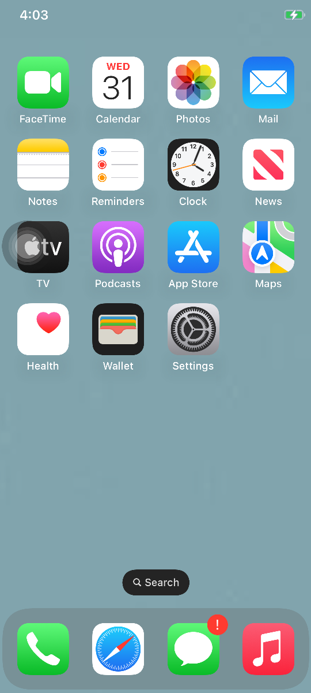

# SkyIOS

**Apple's iOS 16 running on a Redmi Note 10 Pro.**

SkyIOS ports Apple's open-source XNU kernel (xnu-8796, the iOS 16 generation) to the Xiaomi Redmi Note 10 Pro (`sweet`, Qualcomm SM7150 / Snapdragon 732G). On top of it runs the **unmodified iOS 16.7.16 (20H392) userland of the iPhone X**: launchd, the system daemons, backboardd, SpringBoard and the stock apps.

The phone boots to the **iOS lock screen and home screen**. You can unlock it, move between apps with the home gesture, open Settings, and use Control Center, the notification center, the touchscreen and the hardware buttons. A live kernel log streams to the host over USB Ethernet. The Adreno 618 GPU runs at **430 MHz**: the kernel copies every frame to the panel with it, and user space can submit its own command buffers (2D and 3D draws, IOSurfaces). **CoreAnimation's Metal renderer draws the UI on the GPU** through the `SkyAdrenoMetal.bundle` Metal driver — backboardd creates render passes at full 1125×2436 resolution and submits draw commands to the hardware.

> Experimental bring-up, not a usable phone OS. Many things are missing or stubbed (see below), and Apple's security model is mostly switched off. It installs into the `userdata` partition and so **erases Android's user data**.

## Status (2026-11-17)

| Area | State |
| --- | --- |
| Boot | Stock Xiaomi bootloader → `fastboot boot` of our shim → XNU. Nothing is flashed to the boot partitions |
| CPU | All 8 cores (6× Cortex-A55, 2× Cortex-A76) via PSCI, clocks raised from the boot ~300 MHz to 1.8 GHz (A55) / 2.3 GHz (A76) through OSM, 16K pages, GICv3, timers |
| Memory | About 3.95 GiB of the upper DDR bank |
| Storage | Own UFS host driver; the iOS root is a journaled HFS+ volume in `userdata`, read/write |
| iOS userland | Real iPhone X 16.7.16 root filesystem and shared cache; launchd and the system daemons run |
| Display | Kernel IOSurface + IOMobileFramebuffer (`AppleCLCD`) services; CoreAnimation renders in software; each frame is copied into the bootloader's framebuffer by the GPU's 2D engine (asynchronous, CPU copy as fallback). Presented to iOS as an iPhone X panel (1125×2436); optional full-panel scaling with the 3D engine (`sweetfb_scale=1`) |
| GUI | backboardd, SpringBoard, lock screen, home screen, app switching, Control Center, notification center, Settings |
| Touch | Goodix GT9896 over I²C (GENI), rail through RPMh, HID digitizer events; filters bogus (0,0) points and releases a finger when the controller stops reporting |
| Buttons | Power, volume up/down (PMIC through SPMI) as HID consumer keys; lock/wake works |
| USB | Device-mode USB Ethernet (ECM); the kernel console streams to the host as UDP (`skyios usbnet`) |
| App extensions | A built-in "AMFI" MAC policy and an `AppleMobileFileIntegrity` IOService let ExtensionKit trust `System/Library/xpc/extensions.plist`, so app extensions (wallpaper posters, widgets, ...) are registered and launch |
| GPU | Adreno 618 in kernel Rust (`skyios-kernel/`): clocks, CX/GX power, GMU firmware + HFI v1, adreno SMMU, SQE microcode + ringbuffer, zap shader (secure mode off), 2D blits, 3D draws with hand-assembled ir3 shaders (triangle, textured quad, scaled compositor). Accelerator service `SkyAdrenoAccel`: GPU buffers and IOSurfaces mapped for user space, user command buffers under CP register protection, fences. **430 MHz** via DCVS OOB frequency vote |
| Metal | `SkyAdrenoMetal.bundle` (`skyios-metal/`, `sweetaccel=2`): `MTLCreateSystemDefaultDevice()` returns the Adreno; command queues/buffers, `MTLBuffer`, blit fill/copy/mipmap and a render encoder (IOSurface render target, clear, indexed and non-indexed draws with the bundle's built-in shaders, blending from the pipeline state, buffer-backed textures from `MTLBuffer`) run on the GPU. **CoreAnimation's Metal renderer in backboardd draws the UI on the GPU**: render passes at 1125×2436 with 2–5 indexed draws each, submitted via `commitAndWaitUntilSubmitted`. No AIR shader compiler yet — CA pipelines are resolved to built-in ir3 programs via the fragment function key (name + function constants). Five programs: p0 red passthrough, p1 textured quad, p2 fb-blend, p3 CA textured+blend (MVP vertex + premultiplied source-over fragment), p4 CA solid fill (MVP vertex + white fragment) |
| Wi-Fi | WCN3990 ath10k radio in Rust (`skyios-kernel/src/wlan/`, `sweetwifi=1`): copy engine ring DMA, HTC service connect, WMI command channel, HTT data path, passive and active scanning, STA association, WPA2 four-way handshake (PBKDF2 + AES-CCMP), 802.11 data TX/RX. XNU bridge exposes `en0` through BSD `ifnet` and responds to Apple80211 ioctls so `wifid` sees the interface. **Bring-up in progress** |
| Battery | IOPMPowerSource service (static 100 %) |
| Device identity | iPhone X (`iPhone10,3` / `D22AP`): no Home button, gesture UI |
| Activation | Native "Hactivation" path of mobileactivationd, chosen through device-tree security status. No Apple servers involved |

## Evidence

<p align="right">


</p>

**Screenshots from the phone (boots 0112a and 0113t, 2026-11-16).** The iOS 16.7.16 lock screen and home screen with wallpaper, as they appear on the Redmi Note 10 Pro's panel. The kernel copies the framebuffer (every second pixel and row) into spare blocks at the end of `userdata` (`sweetshot=S`), and `skyios shot-pull` turns it into this PNG from recovery: no camera, no editing. The panel is 1080×2400 and iOS draws an iPhone X 1125×2436 frame, so the edges are cropped. The date is 31 December because there is no RTC driver.

### GPU rendering — CoreAnimation on the Adreno 618

**CA Metal draws from backboardd** (`skyios usbnet` live log, probe12 boot). backboardd creates render passes at 1125×2436 and submits indexed draws via the `SkyAdrenoMetal.bundle` Metal driver. The GPU executes them on the Adreno 618 at 430 MHz and presents each frame to the panel in under 2 ms:

```
SWEET GPU: set_freq perf_index 4: OK ret 0x0
SWEET CP: 2D SOLID FILL OK (48x32 rgba8 0xffe08020)
SWEET CP: 3D TRIANGLE OK (64x64 rgba8, 0xff0000ff)
SWEET CP: 3D TEXTURED QUAD OK (64x64 BGRA8 texture, bilinear, 4096 exact)
SWEET CP: present engine ready (panel iova 0x40000000, surface iova 0x80000000)

SWEET ACCEL: backboardd: draw encoder ACCEPTED: 1125x2436 bpr=4608 gpu=0xc007c000
SWEET ACCEL: backboardd: GPU endEncoding: 3 draws, 2 skipped | p0=0 p1=0 p2=0 p3=2 p4=3
SWEET ACCEL: backboardd: GPU endEncoding: 0 draws, 2 skipped | p0=0 p1=0 p2=0 p3=2 p4=0
SWEET ACCEL: backboardd: GPU endEncoding: 1 draws, 2 skipped | p0=1 p1=0 p2=0 p3=2 p4=0
SWEET FB: GPU present 1: 1080x2400, 681 segs, clean 576 us, gpu 1894 us, check 0/64 bad
SWEET ACCEL: backboardd: GPU endEncoding: 3 draws, 2 skipped | p0=0 p1=0 p2=0 p3=2 p4=3
SWEET ACCEL: backboardd: GPU endEncoding: 1 draws, 2 skipped | p0=1 p1=0 p2=0 p3=2 p4=0
SWEET FB: GPU present 2: 1080x2400, 681 segs, clean 578 us, gpu 1854 us, check 0/64 bad
SWEET FB: GPU present 3: 1080x2400, 681 segs, clean 685 us, gpu 1853 us, check 0/64 bad
SWEET FB: GPU present 4: 1080x2400, 681 segs, clean 575 us, gpu 1855 us, check 0/64 bad
```

CA uses five built-in ir3 shader programs: **p3** is the textured+blend program (MVP vertex + premultiplied source-over fragment) that draws the layer atlases, **p4** is the solid fill (MVP vertex + white fragment). Each GPU present frame composites 681 tile segments at 1080×2400 in ~1.9 ms on the GPU. The `check 0/64 bad` column confirms every sampled pixel matches the CPU reference.

**Metal test suite** (`skyios-metal/test/accel-test`, run at boot):

```
skyios-accel-test: metal: device Adreno 618 (SkyIOS)
skyios-accel-test: metal: fill 1 MiB: OK, status 4, 5774 us, first bad -1
skyios-accel-test: metal: copy 1 MiB: OK, status 4, 5471 us, first bad -1
skyios-accel-test: metal: render encoder triangle: OK (red 1922/1922, blue 1922/1922, status 4, 2287 us)
skyios-accel-test: metal: render encoder textured quad: OK (4096/4096 identical, first wrong 0, status 4, 1733 us)
skyios-accel-test: metal: render encoder source-over blend: OK (4096/4096 within 2, 4096 exact, status 4, 1801 us)
```

With the GPU at 430 MHz, a full-screen fill takes ~2.3 ms (was 36 ms at the boot clock). Boot numbers and full logs of every step are in `NOTES.md`.

<br clear="right">

## What does not work (yet)

- **GPU rendering is working but incomplete.** CoreAnimation's Metal renderer in backboardd draws on the GPU at 430 MHz (full-screen fill in ~2 ms). CA pipelines are resolved to five built-in ir3 shader programs via the fragment function key (name + function constants like `image_count`, `framebuffer_fetch`). Buffer-backed textures (CA layer atlases created from `MTLBuffer`) carry their GPU address so the texture descriptor can be built without an IOSurface. Solid fills (program 4, white shader) execute; textured+blend draws (program 3) are still being debugged. There is no AIR shader compiler yet. Post-processing passes (luma boost) fall back to a solid fill. The fragment uber-shader does not yet read CA's constant buffers (FragmentShaderConfig, Uniform), which limits blend correctness.
- **Wallpaper works** (the user's wallpaper image is shown via the legacy poster path with `SkyPBFix.dylib` intercepting the PosterBoard renderer). Changing the wallpaper through Collections is not yet supported (CollectionsPoster returns no descriptors). Details in `NOTES.md`.
- **Wi-Fi is being brought up.** The Rust ath10k radio driver (`skyios-kernel/src/wlan/`) talks to WCN3990 over copy-engine DMA, runs WMI/HTT, scans, associates, and completes the WPA2 four-way handshake. The XNU-side bridge (`en0`, Apple80211 ioctls) is linked in. Heap allocation of the ~120 KB Radio struct via `kalloc` avoids the 16 KB kernel thread stack limit. The driver is not yet confirmed running on-device (early boot log visibility is being resolved).
- **No Bluetooth, cellular, audio, camera, sensors, GPS or SEP / Face ID.** Daemons that only spin without hardware (bluetoothd, fairplayd.H2, the voicemail daemon vmd) are blocked at exec (`sweetnoexec`).
- **Apps:** the system apps plus the 32 "staged" stock apps of the IPSW (Calendar, Notes, Clock, Maps, Mail, Music, Weather, Calculator, ...), moved into `/Applications` by `skyios-ios/stagedapps` and registered by a LaunchServices rebuild (`sweetlsreset=1`). They start from the home screen; whether each one works without network and accounts is not tested. There is no App Store, no Apple ID, and some Settings pages are empty.
- **Security is off:** permissive code signing (AMFI) and sandbox policies, a stub AppleKeyStore, no data protection. Do not put anything personal on it.

## How it boots

```
ABL (stock Xiaomi bootloader, unlocked)
  -> fastboot boot shim-boot.img              (temporary; nothing is flashed to boot)
     -> skyios-shim (Rust, no_std): reads the live FDT, loads the payload from the ramdisk
        -> XNU Mach-O + generated Apple Device Tree (ADT) + boot-args
           -> XNU -> UFS driver -> HFS+ root in the userdata partition
              -> dyld + shared cache -> launchd -> daemons -> backboardd + SpringBoard
```

There is no serial port (the debug UART is wired as SPI on this board). The kernel draws its console into the framebuffer that ABL leaves at `0x9c000000`, and keeps a persistent 4 MiB log ring at the end of `userdata`. You read that log from OrangeFox recovery with `skyios log-pull`, so you don't have to film the screen.

## How to do it yourself

You need a Redmi Note 10 Pro (`sweet`, global or Indian variant, SM7150) with an **unlocked bootloader**, a Linux PC, and a GitHub account for the kernel build. This is the exact path used for the boots above; other variants or firmware may need changes. **Everything on `userdata` is lost.** Bootloaders, recovery, modem and persist partitions are never touched.

### 0. Back up the phone

Boot OrangeFox (or any recovery with adb root) temporarily and pull at least `persist`, `modemst1`, `modemst2`, `fsg`, `fsc` and `boot`, `dtbo`, `vbmeta`. They contain per-device calibration data. Keep them off git; `.gitignore` already excludes `backup/`, `dtb/` and `recovery/`.

The repository is a Cargo workspace. The host tools are one Rust binary, `skyios` (crate `skyios-tool`). Build it once with `cargo build --release` in the repository root; it lands in `target/release/skyios` (`skyios help` lists the subcommands). The commands below call it `skyios`.

The shim needs the stock DTB. Unpack your phone's stock `boot.img`:

```sh
skyios unpack-bootv2 backup/boot.img dtb/boot_unpacked   # -> dtb/boot_unpacked/dtb
```

### 1. Build the kernel

The kernel builds on GitHub's macOS runners with [blacktop/darwin-xnu-build](https://github.com/blacktop/darwin-xnu-build). The workflow fetches xnu-8796, applies `xnu/patches/` in order, and also stages the pinned open-source libpthread, HFS and BearSSL sources it needs. Fork the repo (public repos get free macOS minutes) and run:

```sh
gh workflow run xnu.yml -R YOU/skyios
gh run download RUN_ID -R YOU/skyios -n xnu-kernel -D xnu/out
```

To check a patch locally before spending a CI run, `skyios xnu-cc` replays the compile commands of a previous CI log for single files.

The kernel also builds on a Mac with Xcode 26.5 and the macOS 13.5 KDK: `research/localbuild/` holds a pinned darwin-xnu-build checkout with the patches copied in. The kernel Rust library comes from `skyios-kernel/build.sh` (nightly Rust, custom `aarch64-apple-xnu-sweet` target) and is linked in through `SWEET_RUST_LIB`; see `NOTES.md` for the exact command.

### 2. Build the iOS root image

Download the iPhone X (iPhone10,3) iOS 16.7.16 (20H392) IPSW from Apple. Then, on Linux, with `apfs-fuse`, `hfsprogs` and sudo:

```sh
# OS, SystemOS and AppOS disk images from the IPSW (see BuildManifest.plist for their names)
skyios mkiosroot OS.dmg SystemOS.dmg AppOS.dmg ios16-root.img 16G
sudo fsck.hfsplus -fy ios16-root.img
sudo mount -t hfsplus -o loop,force ios16-root.img /mnt/iosroot
sudo skyios root-tweaks /mnt/iosroot
sudo umount /mnt/iosroot
img2simg ios16-root.img ios16-root.simg
```

`skyios mkiosroot` copies the OS volume and both cryptexes into one case-sensitive journaled HFS+ volume. It adds the dyld cache links, the plain system keybag and the log directories the daemons expect. `skyios root-tweaks` applies the bring-up changes: it skips Setup, seeds the activation state, removes the baseband daemon, disables the watchdogs that kill slow apps and the crash-looping media paths, adds the USB Ethernet network service, and so on. `NOTES.md` explains each change. Inside a linux/arm64 container use a static build: `cargo build --release --target aarch64-unknown-linux-musl` (see `NOTES.md`).

The device tree builder copies `/product` from the real iPhone X device tree, which MobileGestalt needs. Extract it once, without downloading the whole IPSW:

```sh
skyios remotezip IPSW_URL DeviceTree.d22ap.im4p research/ipsw-x/dt
ipsw img4 im4p extract research/ipsw-x/dt/Firmware/all_flash/DeviceTree.d22ap.im4p -o research/ipsw-x/d22ap.adt
```

### 3. Build the boot image

Needs the Rust target `aarch64-unknown-none-softfloat` (`rustup target add aarch64-unknown-none-softfloat`). No cross gcc or `mkbootimg`: `skyios mkshim` packs the boot.img (byte-identical to `mkbootimg --header_version 2`).

```sh
skyios mkadt skyios-shim/out/sweet.adt --highmem
skyios mkpayload xnu/out/kernel.development.sweet skyios-shim/out/sweet.adt skyios-shim/out/payload.bin \
    --cmdline 'debug=0xc serial=3 cpus=8 keepsyms=1 -enable_kprintf_spam -noprogress rd=ufsroot0 unentitled_ios_sim_launch=1 ignition_level=1 wdt_test=no_user_checkin ufsrw=1 rootrw=1 launchd_unsecure_cache=1 wdt=-1 sweetfb_noconsole=1 sweetfb_hz=60 sweetusb=2 sweettouchic=1'
skyios-shim/build.sh skyios-shim/out/payload.bin   # -> skyios-shim/out/shim-boot.img
```

What the less obvious boot-args do:

| Boot-arg | Effect |
| --- | --- |
| `rd=ufsroot0 ufsrw=1 rootrw=1` | Root on the `userdata` partition, writable |
| `cpus=8` | Start all eight cores; `cpus=1` is the safe fallback |
| `launchd_unsecure_cache=1` | launchd accepts its job cache without AMFI |
| `wdt=-1 wdt_test=no_user_checkin` | No XNU watchdog |
| `sweetfb_noconsole=1` | Stop drawing kernel text over the GUI. It still goes to the persistent log; panics are drawn |
| `sweetfb_hz=60` | Panel refresh rate of the CPU copy |
| `sweetusb=2` | USB Ethernet with the live UDP console |
| `sweettouchic=1` | Use the Goodix GT9896 (`2` = Focaltech) |
| `sweettouch=0`, `sweetkeys=0` | Disable the touch or button driver |
| `sweetnoexec=a,b` | Refuse exec of these process names (default `bluetoothd,fairplayd.H2,vmd`) |
| `sweettop=5` | Per-process CPU usage every 5 s |
| `sweetgpu=N`, `sweetgpu_delay=S` | Run the Adreno bring-up up to stage N, S seconds after the root mount |
| `sweettouchdot=1` | Draw a red cross at the raw touch point (touch debugging) |
| `sweetfb_gpu=0`, `sweetfb_scale=1` | Present with the CPU instead of the GPU; scale the frame to the full panel with the 3D engine |
| `sweetaccel=1` / `2` | Publish the GPU accelerator service (root only) / also the Metal device (`IOAcceleratorES` + `SkyAdrenoMetal.bundle`) |
| `sweetmetal_procs=a,b` | Processes the Metal device is offered to (default `skyios-accel-test`); others keep software rendering |
| `sweetrun=NAME` | Run the test tool installed from the boot payload (`skyios mktool`) once in place of the first exec of NAME |
| `sweetwdog=S` | Arm the APSS hardware watchdog: a hung kernel resets after S seconds |
| `sweetreboot=S` | Reset S seconds after boot (unattended test cycles; lands in recovery) |
| `sweetreducetransp=1` / `2` | Write Reduce Transparency + Reduce Motion before userland / restore the original prefs |
| `sweettouchsim=S` | 20 synthetic swipes S seconds after the touch driver starts (lag measurements) |
| `sweetunlocksim=S` | Wake the display if needed and swipe up from the bottom edge (home gesture) at S seconds |
| `sweetdyldvars=1` | Let dyld honour `DYLD_*` variables (answers the AMFI dyld-policy call) |
| `sweetinsert=NAME:PATH` | Add `DYLD_INSERT_LIBRARIES=PATH` to every exec of a binary called NAME (used for SpringBoard + `SkyPBFix.dylib`) |
| `sweetwifi=1` | Start the WCN3990 ath10k WLAN radio driver (Rust) and the XNU WiFi bridge (`en0`) |
| `sweetbattery=1` | Publish the IOPMPowerSource battery service |
| `sweetpowersim=S`, `sweetpowersim_every=T` | Press the power key at S seconds (up to 8 times, T apart) when the display is off, for unattended screenshots |
| `sweetshot=S`, `sweetshot_every=T` | Screenshot of the panel S seconds after the log starts (up to 4, T seconds apart), read with `skyios shot-pull` from recovery |

### 4. Flash the root and boot

```sh
fastboot -S 512M flash userdata ios16-root.simg   # ~7 minutes; do not unplug
# Xiaomi's fastboot often hangs after a large flash: re-enter fastboot with Power + Volume down
fastboot boot skyios-shim/out/shim-boot.img
```

The first boot takes about 4–5 minutes on the Apple logo, then the lock screen appears. Swipe up to unlock. To get back to fastboot, hold Power + Volume down.

### 5. Read the kernel log

With `sweetusb=2` the console streams live over USB Ethernet once the root is mounted:

```sh
skyios usbnet logs/live.txt
```

The persistent ring at the end of `userdata` also has the early lines (and `skyios shot-pull OUT` reads `sweetshot` screenshots the same way):

```sh
fastboot boot recovery/recovery.img        # OrangeFox, temporary
skyios log-pull logs/boot.txt            # 4 MiB console ring from the end of userdata
adb reboot bootloader
```

The log contains crash reports with backtraces (`CRASH name ...`), IOKit traces of backboardd and SpringBoard, and the drivers' `SWEET ...` lines. `skyios crash` symbolicates them against the shared cache.

### QEMU

`skyios qemu` boots the same kernel on QEMU `virt` with a test RAM-disk root. It is useful for kernel-only changes; see `NOTES.md`.

## Repository layout

| Path | What |
| --- | --- |
| `Cargo.toml` | Workspace: `skyios-kernel`, `skyios-shim`, `skyios-tool` |
| `skyios-shim/` | Bare-metal boot shim in Rust (`no_std`, position-independent, self-relocating; entry and vectors via `global_asm!`), packed as an Android boot.img v2 by `skyios mkshim` |
| `xnu/patches/` | The XNU patch series (applied in order by CI), plus staging scripts for libpthread, HFS and BearSSL |
| `.github/workflows/xnu.yml` | Kernel CI build |
| `skyios-tool/` | The `skyios` host tool (Rust), one subcommand per job below |
| `skyios-kernel/` | Rust linked into the kernel: cmd-db reader, Adreno 618 / GMU / SMMU bring-up, command processor, 2D/3D engines, present engine, user command submission, watchdog, WCN3990 ath10k WLAN radio (copy engine, HTC/WMI/HTT, scan, STA, WPA2, data TX/RX) |
| `skyios-ios/` | Small iOS tools run at boot by `sweetrun`: `stagedapps` (installs the staged stock apps), `wallpaper` (wallpaper attempt) |
| `skyios-metal/` | User space for the GPU: `bundle/` = `SkyAdrenoMetal.bundle` (Metal device + recording stand-ins), `test/` = `accel-test` (GPU tests run on the phone at boot) |
| `skyios usbnet` | Bring up the phone's USB Ethernet on the host and stream the live kernel log |
| `skyios mkadt` | Generates the Apple Device Tree from sweet's MMIO layout and the iPhone X identity |
| `skyios mkshim` | Turns the shim ELF into a flat arm64 Image and packs boot.img v2 (shim + payload + stock DTB) |
| `skyios mkpayload` | Packs kernel + ADT + boot-args into the shim payload |
| `skyios mktool` | Packs files for the boot-time installer (`mkpayload --ramdisk`): test tools, bundles |
| `skyios mkiosroot` | Builds the HFS+ iOS root from the IPSW images (Linux) |
| `skyios root-tweaks` | Bring-up changes to the root (Setup skip, activation, daemons) |
| `skyios log-pull`, `skyios log` | Read the persistent kernel log from recovery |
| `skyios shot-pull` | Read `sweetshot` screenshots from recovery as PNG |
| `skyios crash` | Symbolicate console crash reports |
| `skyios xnu-cc` | Local single-file compile check from a CI log |
| `skyios qemu` | QEMU test boots with framebuffer text decoding |
| `skyios adt`, `remotezip`, `unpack-bootv2`, `sparsediff`, `mkinit`, `patch-launchd-plist`, `check-exports`, `validate-repo`, `udp-listen`, `gen-font` | Helpers (`gen-font` regenerates `skyios-shim/src/font.rs`) |
| `NOTES.md` | Detailed engineering log: every boot, crash and decision, plus hardware facts |

Not in git: partition backups, live device trees, recovery images, Apple firmware and root images, and downloaded or generated build trees. They contain device serials and calibration data, or Apple's copyrighted files.

## Kernel patches

| # | What |
| --- | --- |
| 0001–0009 | Toolchain compatibility, SWEET machine config, non-PAC arm64, stubs for Apple-internal pieces |
| 0010–0018 | Early framebuffer console, physmap fix, PRNG without corecrypto, device-tree platform expert, timer PPI, boot CPU driver |
| 0019–0020 | Apple open-source libpthread kernel provider; BearSSL AES |
| 0021–0027 | RAM-disk root, mockfs, SHA-256, minimal AMFI, Apple open-source HFS+, MD5 |
| 0028–0034 | UFS host driver and root device, read/write root, DMA above 4 GiB |
| 0035–0045 | Entitlements, bindfs, AppleKeyStore stub, IOWatchdog, console crash reports |
| 0046 | IOSurface (IOCoreSurfaceRoot) and IOMobileFramebuffer (AppleCLCD) services |
| 0047–0055 | Diagnostics: persistent log, /dev/null tee, IOKit trace, heap strings and user stack sampler on crash; permissive Sandbox policy; HFS rename-swap; AppleKeyStore selectors |
| 0056–0057 | Throttled panel copy; no external identity resolver |
| 0058 | HID event services. Apple's IOHIDFamily-1915.140.3 user client and event queue, matching the iOS 16.7 userland |
| 0059 | iPhone X identity (`hw.product` / `hw.target` from the device tree) |
| 0060 | Power and volume keys over SPMI; touch over GENI I²C |
| 0061 | Present the display as 1125×2436 |
| 0062 | RPMh regulator vote for the touch rail; battery power source |
| 0063 | GENI FIFO packing fix and the Goodix GT9896 protocol |
| 0064 | Grant PRIV_WORK_INTERVAL (UIKit's CoreAnimation work interval) |
| 0065 | SMP: secondary A55 cores via PSCI CPU_ON |
| 0066–0067 | Fault-region crash info; console mute |
| 0068 | IOSurface lookup semantics for already-mapped surfaces |
| 0069 | Batched persistent-log flushes |
| 0070–0071 | `pid_hibernate` syscall (SpringBoard app switching); edge-swipe flags on touches |
| 0072–0077, 0081 | USB device controller, VBUS override, ECM USB Ethernet, live UDP console, link state |
| 0078 | SMP: all 8 cores |
| 0079–0080 | Display power (lock/wake); network trace |
| 0082 | Touch controller selection (GT9896 / Focaltech) |
| 0083 | Xcode 16+ IIG/IORPC compatibility (local builds) |
| 0084 | CPU and L3 frequencies through OSM |
| 0085–0086 | Frame statistics; present inside SwapEnd; touch retry |
| 0087, 0089, 0090, 0093 | Rust kernel library (`skyios-kernel/`) and its C hooks: log, panic, MMIO map, boot-args, delays, threads, contiguous DMA memory, cache maintenance |
| 0088 | Per-process CPU usage (`SWEET TOP`) |
| 0091 | `sweetnoexec`: refuse exec of crash-looping daemons |
| 0092, 0095, 0096, 0098 | Boot-time root fixes: PosterBoard assert, SpringBoard feature-flag override, early boot notes in the live log, LaunchServices store reset |
| 0094, 0100, 0101 | Touch: ignore (0,0) points, touch-dot debugging and hold times, release a stuck finger |
| 0097, 0099 | "AMFI" MAC policy syscalls and the `AppleMobileFileIntegrity` IOService (extension point cache trust) |
| 0102–0104 | IOKit busy dump; stand-ins for IOKit daemons and the network stack |
| 0105 | GPU present: 2D copy of each frame, optional 3D scaling |
| 0106–0108 | Reduce Transparency option, scaled touch mapping + synthetic swipes, sampler timing |
| 0109 | GPU accelerator service + user client (buffers, IOSurface import, submit, wait), Metal `IOAcceleratorES` |
| 0110 | Boot-time tool installer from the payload and `sweetrun` exec redirect |
| 0111 | `sweetshot` panel screenshots into spare blocks at the end of `userdata` |
| 0112 | `sweetpowersim` power key and `sweetunlocksim` home gesture simulation |
| 0113 | AMFI dyld policy (`sweetdyldvars`) and `sweetinsert` library insertion |
| 0114 | Battery gauge and charger stubs |
| 0115 | Wi-Fi: `en0` BSD interface, Apple80211 ioctl bridge, Rust radio hooks (`sweet_sta_init`, `sweet_wlan_*`) |

## Key hardware facts

- RAM: payloads use the upper bank, `0x100000000` + `0xfcc00000` (about 3.95 GiB), above Qualcomm's protected carve-outs.
- GICv3 with security extensions: the timer goes through Group 1 IRQ (virtual timer INTID 19), not FIQ as on Apple silicon.
- PSCI through `smc`, 19.2 MHz timer, ARMv8.2 without pointer authentication. MPIDR uses Aff1 for the core number.
- Panel: 1080×2400 DSC video mode, continuous splash from ABL, no refresh kick needed.
- Touch: Goodix GT9896 at I²C `0x5d` on QUP SE7 (`0xa84000`), powered by PM6150L LDO11 through RPMh.
- Buttons: power and volume down on the PM6150 PON block, volume up on PM6150L GPIO2 (SPMI SID 4).
- WLAN: WCN3990 (integrated ath10k, 802.11ac 2×2), copy-engine DMA, SMMU SID `0x1A0`.

More in [`NOTES.md`](NOTES.md).

## Credits

SkyIOS is built on Apple's open-source releases (xnu, IOHIDFamily, libpthread, hfs), [BearSSL](https://bearssl.org), [blacktop/darwin-xnu-build](https://github.com/blacktop/darwin-xnu-build), [ipsw](https://github.com/blacktop/ipsw), Qualcomm/Xiaomi's published Linux kernel sources for the hardware details, and [OrangeFox Recovery](https://orangefox.download), the Linux `drm/msm` Adreno driver as the reference for the GPU bring-up, and [macos-UnifiedLogs](https://github.com/mandiant/macos-UnifiedLogs) for reading iOS logs. iOS itself is Apple's and is not distributed here.
